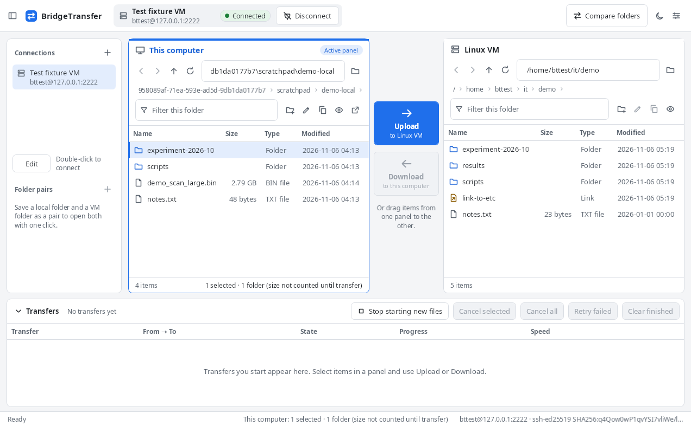

# BridgeTransfer

A Windows desktop application for moving files between **this computer** and a **Linux VM** over
SSH/SFTP: two clear file panels, an honest transfer queue, careful handling of existing files, and a
reviewed one-way folder synchronization. Built with C#, .NET 10 and WPF; SFTP through
[SSH.NET](https://github.com/sshnet/SSH.NET).



> **Status:** version 1.0.0. The engine and SFTP behaviour are covered by automated tests against a
> real OpenSSH server, and the interface was exercised under Wine. The packaged single-file
> `BridgeTransfer.exe` was built on Linux and **has not yet been launched on a Windows PC**. See
> [docs/TEST_REPORT.md](docs/TEST_REPORT.md) and [docs/KNOWN_LIMITATIONS.md](docs/KNOWN_LIMITATIONS.md).

## Getting started

1. Copy `dist\BridgeTransfer.exe` anywhere (for example `C:\Tools\BridgeTransfer\`) and double-click
   it. No installer, .NET runtime, Python or other software is needed. The file is not code-signed,
   so SmartScreen may ask for confirmation the first time.
2. Select **Add connection** (or `+` next to *Connections*) and enter:
   - a name, the VM's host name or IP address, the port (22 by default) and your user name on the VM;
   - **Private key**: the path to your key file, for example `C:\Users\you\.ssh\id_ed25519`
     (OpenSSH, PuTTY `.ppk` v2/v3 and PEM keys; passphrases are supported), or **Password**.
   - optionally the folders to open on each side.
   Use **Test connection** to check it, then **Save**.
3. Select **Connect**. The first time, BridgeTransfer shows the server's fingerprint. Compare it with
   the VM (`ssh-keygen -lf /etc/ssh/ssh_host_ed25519_key.pub`) and choose **Trust and connect**.

Passwords and passphrases are asked for when you connect and are never saved.

## Everyday transfers

- Select files or folders in **This computer** and choose **Upload → to Linux VM**, or select items
  in **Linux VM** and choose **← Download to this computer**. You can also drag items from one panel
  to the other, or drag files from Windows Explorer onto the Linux panel.
- Before anything starts, BridgeTransfer shows the exact destination paths. Uploading the folder
  `project` into `/data` creates `/data/project`, including empty sub-folders.
- If a file already exists you choose **Skip**, **Keep both** (saves `name (2).ext`) or **Replace**.
  A newer file at the destination is never replaced without asking.
- The queue at the bottom shows progress, speed and time left, and lets you cancel, retry failed
  items, clear finished ones or stop starting new files.

## One-way synchronization

**Compare folders** scans a folder on this computer and a folder on the VM, then shows what would
change in one direction (upload or download) before anything is copied. New files and files that are
newer on the source are proposed; everything else needs your explicit choice. Nothing is ever
deleted. See [the user guide](docs/USER_GUIDE.md#one-way-synchronization).

## Where data is kept

`%LOCALAPPDATA%\BridgeTransfer\` holds `settings.json` (connections, folder pairs, options),
`known_hosts.json` (trusted server keys), `queue.json` (unfinished transfers) and `logs\`
(rotating, passwords removed). Nothing is sent anywhere else.

## Building

Requirements: Windows 10/11 x64 with the .NET 10 SDK (10.0.1xx; pinned in `global.json`) and
PowerShell 7. Visual Studio is not needed.

```powershell
.\scripts\build.ps1
```

```powershell
.\scripts\test.ps1
```

```powershell
.\scripts\publish.ps1
```

`publish.ps1` builds, runs the tests, publishes a self-contained single-file Release build for
win-x64, validates it and writes `dist\BridgeTransfer.exe` and `dist\BridgeTransfer.exe.sha256`.
A failed run leaves no executable in `dist`. Use `-SkipTests` to skip the test step.

The scripts also run on Linux with PowerShell 7 and the .NET 10 SDK (the Windows projects build
there through `EnableWindowsTargeting`); that is how the current executable was produced.

Package versions are pinned in `Directory.Packages.props`, restore uses the committed
`packages.lock.json` files, and the product name and version are set centrally in
`Directory.Build.props` (and `AppInfo.ProductName`).

### Tests

- `tests/BridgeTransfer.UnitTests`: engine rules with an in-memory file system and fault injection.
- `tests/BridgeTransfer.IntegrationTests`: real SSH.NET against an isolated OpenSSH server. Start it
  with `tests/fixture/start-sftp-fixture.sh` on a disposable Linux machine or WSL (see
  [tests/fixture/README.md](tests/fixture/README.md)); without it these tests are skipped.

## Project layout

```text
src/BridgeTransfer.Core            Models, path and name rules, transfer engine, queue, comparison
src/BridgeTransfer.Infrastructure  SFTP (SSH.NET), local file system, settings, logging
src/BridgeTransfer.App             WPF views, view models, themes
tests/                             Unit tests, integration tests, SFTP fixture
scripts/                           build.ps1, test.ps1, publish.ps1
docs/                              User guide, test report, known limitations, screenshots
.github/workflows/                 Windows build and smoke test (prepared, not run)
```

## Licenses

BridgeTransfer uses SSH.NET, BouncyCastle, CommunityToolkit.Mvvm and the .NET runtime, all under the
MIT license. See [THIRD-PARTY-NOTICES.txt](THIRD-PARTY-NOTICES.txt) (also shown under
*Settings → About and licenses*).
