# BridgeTransfer user guide

> Screenshots were taken from the real application running under Wine on Linux against a local
> test SFTP server with sample files. Fonts are open-source substitutes for Segoe UI, so text looks
> slightly different on Windows. Dialogs are shown without the Windows title bar.

## The main window

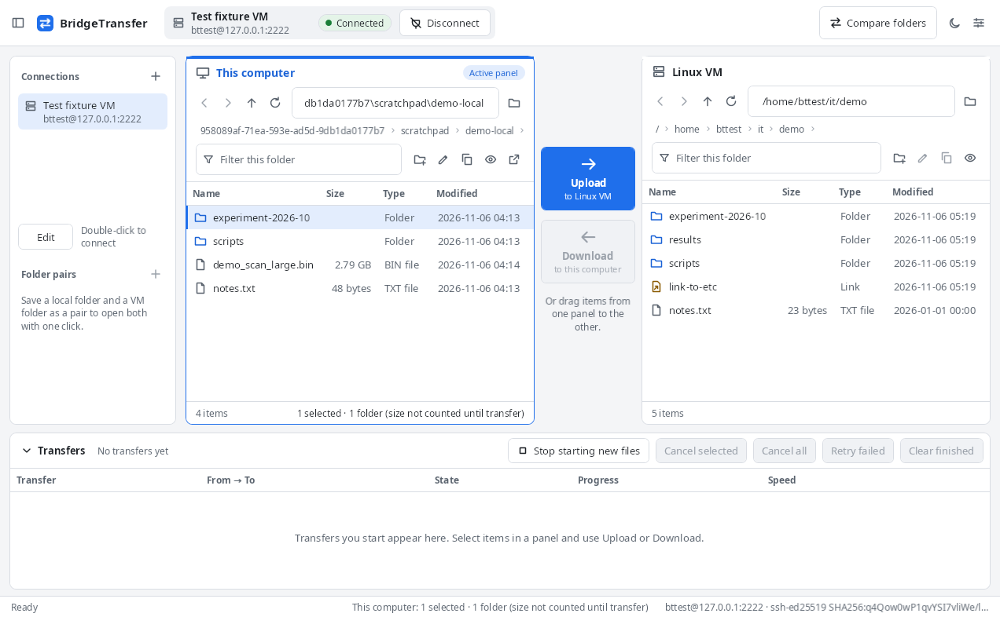

- **Top bar**: the selected connection, its state (*Not connected*, *Connecting…*, *Connected*,
  *Connection lost*, always with a text label), Connect/Disconnect, **Compare folders**, the
  light/dark switch and Settings.
- **Sidebar** (hide it with the button at the top left): saved connections and folder pairs.
- **This computer** (left) and **Linux VM** (right). The active panel has a coloured frame and an
  *Active panel* label. Each panel has Back, Forward, Up, Refresh, an editable path (press Enter),
  clickable breadcrumbs, a filter for the current folder, New folder, Rename and Copy full path.
  Click a column header to sort by name, size, type or modified time; folders stay on top. The eye button shows or hides hidden items (in both panels).
- **Upload → to Linux VM** and **← Download to this computer** between the panels.
- **Transfers** at the bottom (collapse it with the arrow, resize it by dragging its top edge).
- **Status bar**: what is happening now, the selection in the active panel and the server identity.

The filter only shows matching names in the folder you are looking at; it does not search
sub-folders. Links are shown with their own icon and the type
*Link*.

Double-click a folder to open it. On **This computer**, double-clicking a file opens it with its
Windows application. On the **Linux VM**, double-clicking a file does nothing: remote files are never
downloaded and run automatically.

## Connecting

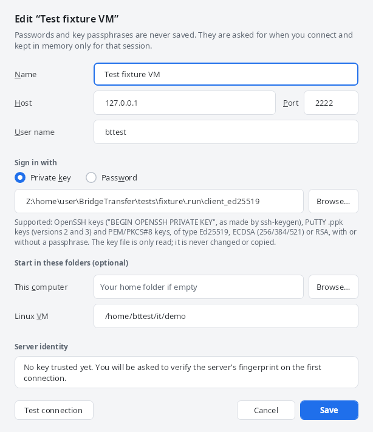

Add a connection with `+`. Choose **Private key** and browse to your key file, or **Password**. The
key file is only read. Passwords and passphrases are asked for at connect time and are not saved.

The first time you connect to a server you see its fingerprint:

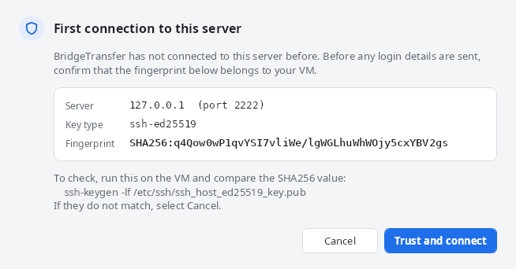

Compare it with the VM (`ssh-keygen -lf /etc/ssh/ssh_host_ed25519_key.pub`). Only **Trust and
connect** sends your login details. If the server's key ever changes, the connection is blocked and
both fingerprints are shown. If you know why (for example, the VM was rebuilt), open the connection
with **Edit** and choose **Forget trusted key**, then connect again and verify the new fingerprint.

If the VM becomes unreachable, the state changes to *Connection lost* and the Linux panel offers
**Reconnect**. Transfers in progress retry on their own for a short time.

## Transferring files

Select items and choose **Upload** or **Download**, or drag them to the other panel (drop on a folder
row to copy into that folder). BridgeTransfer first shows exactly where the items will go, and lets
you decide up front what happens to files that already exist, so a large transfer never stops to ask:

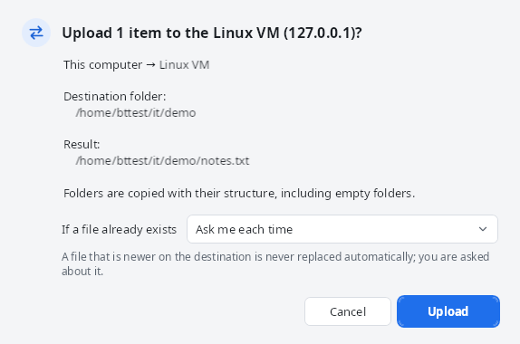

(You can turn this confirmation off in Settings; the default choice for existing files is set there too.)

The queue shows each transfer with its direction, source and destination, state, bytes copied,
speed and an estimate of the time left once enough data has been measured:

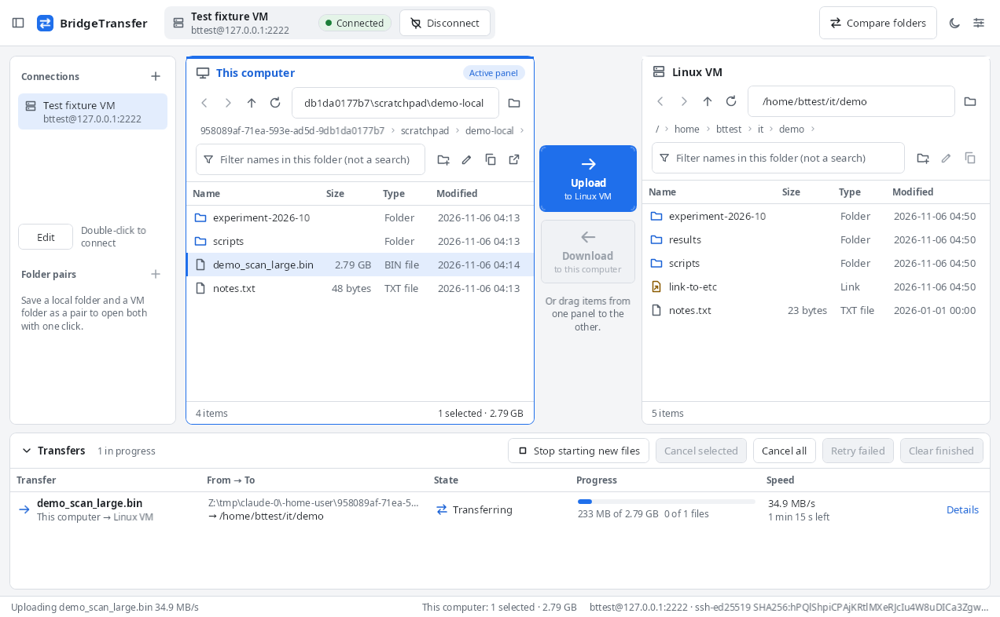

States: *Queued*, *Scanning* (reading a folder), *Transferring*, *Waiting for decision*, *Completed*,
*Completed with warning*, *Failed*, *Cancelled*, *Skipped*. A folder transfer reports the real
result of all its files; **Details** lists every file that failed, was skipped or needed a retry,
with the reason.

Queue buttons: **Stop starting new files** (files already running finish), **Cancel selected**,
**Cancel all**, **Retry failed** (checks everything again first) and **Clear finished**.

### How a file is copied safely

1. The file is written under a temporary name in the destination folder, such as
   `.bt-staging-1a2b3c4d-5e6f7a8b-9c0d1e.part`. The final name is never used for a partial file.
2. When the copy is complete, BridgeTransfer checks that the number of bytes matches the source and
   that the source did not change while it was read.
3. Only then is the temporary file renamed to the final name. If you chose to replace an existing
   file, that file stays in place until this rename.

If anything goes wrong, the temporary file is removed and the destination is left as it was.
Version 1 does not resume: an interrupted file is copied again from the start.

## When a file already exists

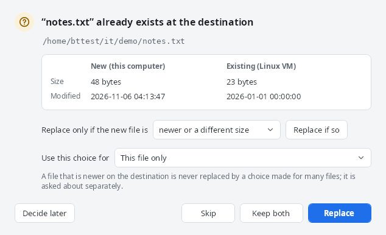

- **Skip** leaves the existing file and does not copy this one.
- **Keep both** copies this file as `name (2).ext` (or the next free number).
- **Replace** replaces the existing file. If the existing file is *newer*, the dialog says so and the
  button reads **Replace newer file**.
- **Replace only if the new file is…** *newer*, *a different size*, or *newer or a different size*,
  then **Replace if so**. When the condition is not met, the file is skipped. "Newer" means modified
  more than 2 seconds later.
- **Use this choice for**: *this file only*, *all files in this transfer*, or *all files in every
  transfer in the queue* (files already waiting are resolved at once, and later ones use the same
  choice).
- **Decide later** leaves the file waiting; the queue row shows **Decide…** so you can come back.

The same choices are offered in the confirmation before a transfer starts (*If a file already
exists*), and a default can be set in Settings.

One safeguard always applies: a file that is **newer on the destination** is never replaced by a
choice made for many files or chosen in advance. It is asked about on its own (and you can answer
*Skip* for all of them at once). *Replace if newer* simply skips such files.

A file never replaces a folder or link of the same name; only Skip and Keep both are offered then.
If the VM's SFTP server cannot replace a file in one step, the existing file is kept and the
transfer is reported as failed with that explanation.

Renaming in a panel never overwrites another item either.

## Speed

Large files run at the speed of the network. Many small files are limited by the delay of each
request to the VM rather than by bandwidth, because every file needs several requests (create the
temporary file, write, verify, set the time, rename). Transferring several files at once hides most
of that delay: set **Files transferred at the same time** in Settings to 6–8 for folders with many
small files (up to 10; each uses its own connection). Skipping existing files is fast because each
destination folder is listed once instead of checking every file.

## One-way synchronization

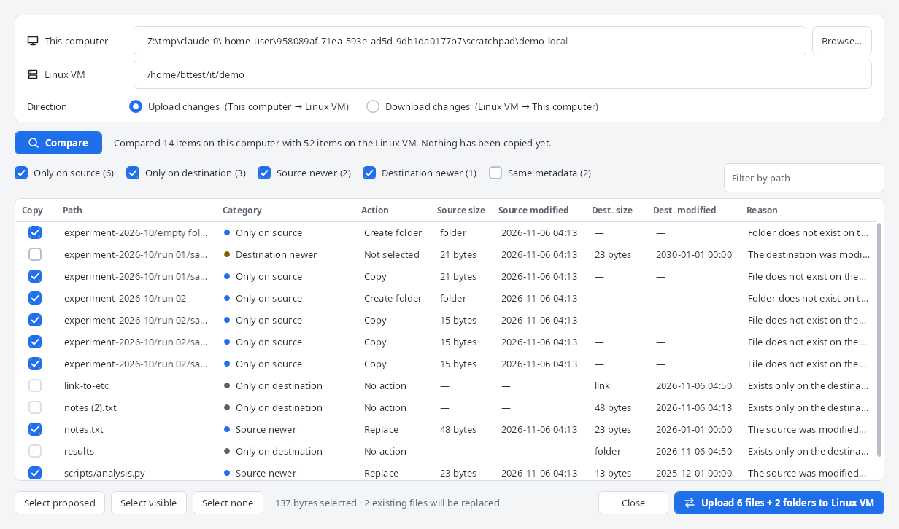

1. Choose the folder on this computer and the folder on the VM (they start with the folders shown
   in the panels).
2. Choose **Upload changes** (This computer → Linux VM) or **Download changes** (Linux VM → This
   computer).
3. Select **Compare**. Both folders are scanned; this never changes any file.
4. Review the list. Each row shows the path, a category, the action, sizes and times on both sides
   and the reason. Use the category boxes and the path filter to narrow the list.
5. Tick or untick rows (Space toggles the selected rows), then select the button that states the
   direction and the number of files, for example **Upload 6 files + 2 folders to Linux VM**.
6. The plan runs through the normal transfer queue. The result is summarised at the top.

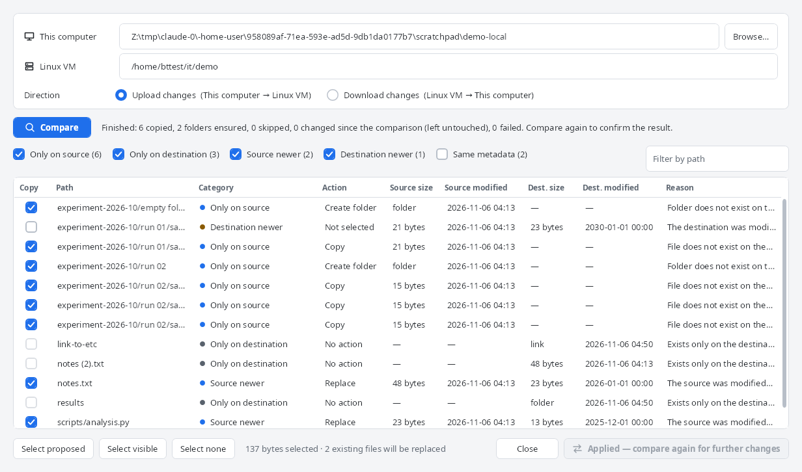

| Category | Meaning | Selected by default |
|---|---|---|
| Only on source | New file or folder | Yes |
| Source newer | Changed on the source; the destination copy is replaced | Yes |
| Destination newer | Changed on the destination later; replacing it needs confirmation | No |
| Same metadata | Same size and modified time (within 2 s). Contents are **not** compared | No (hidden by default) |
| Same or unclear time, different size | Cannot tell which is newer | No |
| Only on destination | Left untouched. Nothing is ever deleted | Not selectable |
| File/folder conflict | A file on one side, a folder on the other | Not selectable |
| Unsupported name or case collision | Cannot be stored on Windows, or two names differ only by case | Not selectable |
| Skipped link | Links and special files are not followed or copied | Not selectable |
| Unreadable or incomplete scan | A folder could not be read; its contents are unknown, not missing | Not selectable |

Just before copying, every selected item is checked again. If something changed since the
comparison, it is moved to **Needs review** and nothing is copied for it; compare again to see the
new situation. Each file is checked once more right before it is written.

This is one-way synchronization only: no deletions, no mirroring, no two-way merging, no background
watching and no schedule.

## Folder pairs

With a local folder and a VM folder open, select `+` next to **Folder pairs** to save them under a
name. Clicking the pair later connects (if needed) and opens both folders. Right-click to rename or
remove it; removing a pair never touches files.

## Interrupted transfers

If BridgeTransfer closes unexpectedly while transferring, the next start lists what did not finish:

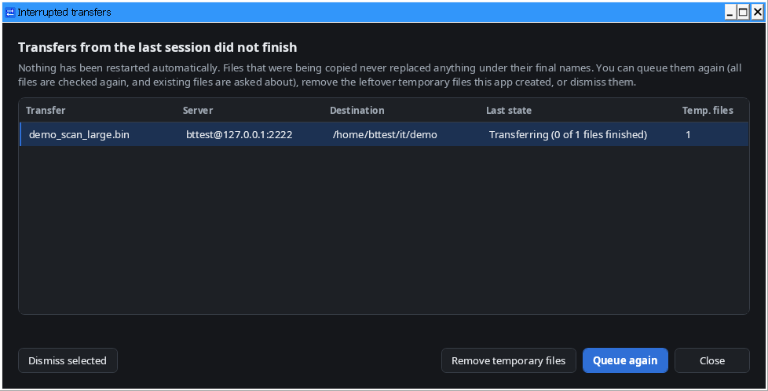

Nothing restarts automatically. You can:

- **Queue again**: the original selection is scanned again with fresh checks; files that were
  already copied are reported as existing and you decide what to do with them.
- **Remove temporary files**: deletes only the temporary `.bt-staging-…part` files this application
  recorded, and only if they still exist. Files on the VM need a connection to the same server; the
  **Interrupted (n)…** button in the Transfers header reopens this list after you connect.
- **Dismiss**: forget the entry.

When you close the window while transfers are running you can keep it open, or cancel the
transfers and exit:

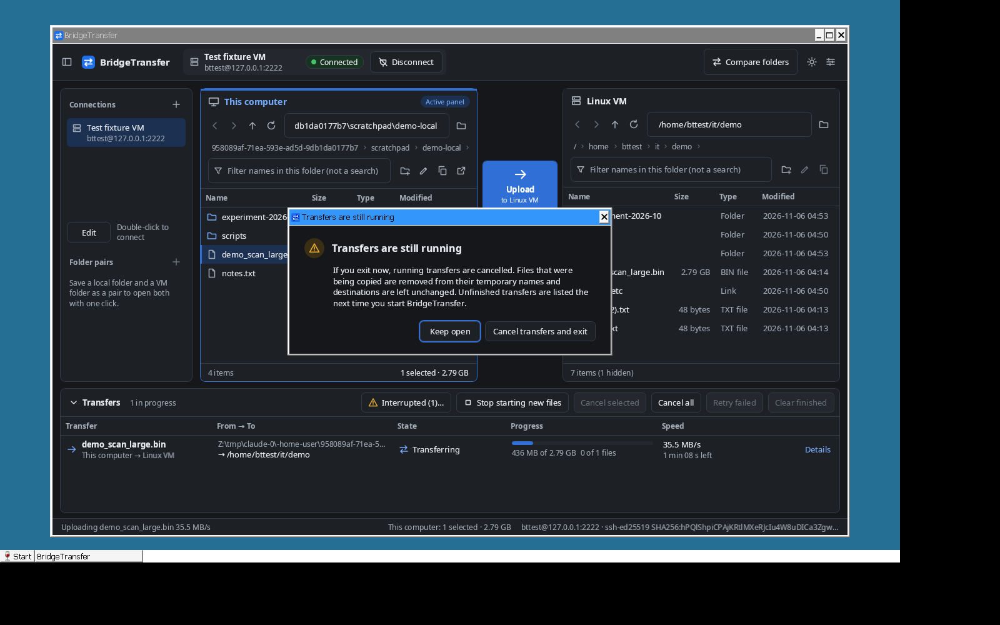

## Settings and themes

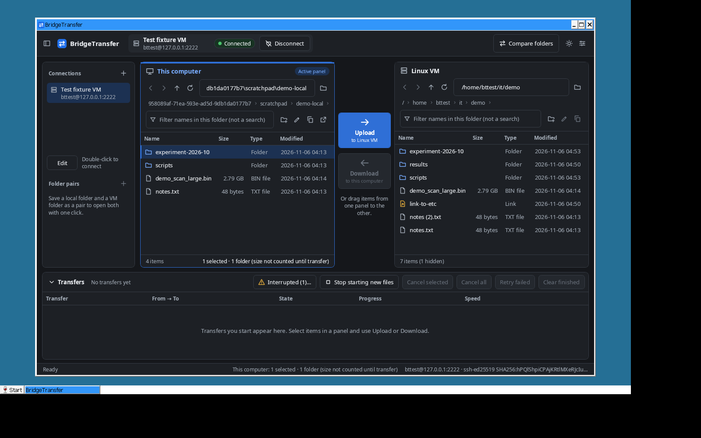

Settings: light or dark theme, files transferred at the same time (1–10, default 2), what to do
when a file already exists, preserving modification times, the transfer confirmation, connection and
operation timeouts and keepalive.
**Export support log** saves the log as a zip where you choose; passwords are removed, but file and
host names can appear, so check it before sharing. Nothing is uploaded.

## Keyboard shortcuts

| Keys | Action |
|---|---|
| Ctrl+L | Edit the path of the active panel |
| Ctrl+F | Filter the active panel |
| F5 | Refresh |
| Alt+Up or Backspace | Parent folder |
| Alt+Left / Alt+Right | Back / Forward |
| Enter | Open the selected folder (or local file) |
| F2 | Rename |
| Ctrl+A | Select all |
| Ctrl+Tab | Switch between the panels |
| Esc | Close a dialog (in the conflict dialog: decide later) |

No shortcut deletes anything; deleting is not part of version 1.
